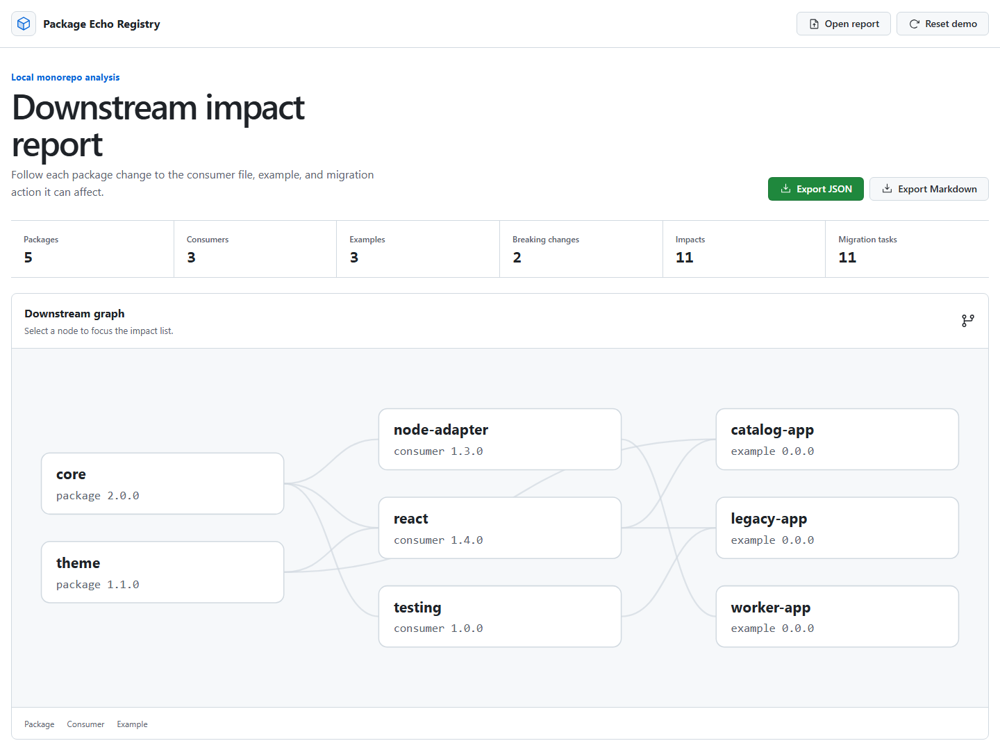

# Package Echo Registry

[](https://github.com/KanadeK/package-echo-registry/actions/workflows/ci.yml)
[](https://github.com/KanadeK/package-echo-registry/releases)
[](LICENSE)

[English](README.md)

Package Echo Registry 是面向 SDK 团队和 monorepo 维护者的本地优先 TypeScript 分析器。
它把 package/API 变化连接到下游 consumer、示例、具体源码位置和迁移任务。当前版本为
**v0.1.0**。

它与发布说明生成器或通用 affected-task 图的区别是：每条影响都必须带有有向 package
路径和仓库相对证据。



## 为什么使用

- 比较新旧 API Extractor JSON 快照。
- 导入 npm 兼容的 workspace manifest 和 Changesets。
- 用 ts-morph 把 TypeScript 命名导入定位到 consumer 文件与行号。
- 检测 API 删除/签名变化、不兼容 peer range 和示例破坏风险。
- 用 Graphology 追踪 package 到 consumer 再到 example 的路径。
- 生成可审查证据、风险等级和去重后的迁移任务。
- 在支持键盘操作的 React 页面中查看同一份版本化报告。
- 无需访问 registry 或上传源码即可导出校验过的 JSON/Markdown。

## 快速开始

需要 Node.js 22.12 或更高版本以及 npm。

```bash
git clone https://github.com/KanadeK/package-echo-registry.git
cd package-echo-registry
npm ci
npm run demo
npm run dev
```

`npm run demo` 会离线分析仓库内 fixture，并生成：

- `dist-demo/package-echo-report.json`
- `dist-demo/package-echo-report.md`

开发服务器用 Web explorer 打开同一报告。整个过程不需要公共 registry 或 GitHub Token。

## 真实输入到真实输出

fixture 含 5 个 package 单元、3 个 app、10 份 API 快照、2 个 Changeset 和 9 处源码用法。
旧版 `@echo/core` 导出 `parseEnvelope`，v2 删除了它，但 `@echo/react` 仍然导入该成员，
并声明了不兼容的 peer range `^1.0.0`。

```text
@echo/core
  -> @echo/react (packages/react/package.json)
  -> @echo/catalog-app (apps/catalog/package.json)

源码: apps/catalog/src/main.tsx:1
风险: example-breakage / high
任务: Migrate @echo/catalog-app away from parseEnvelope
```

真实 demo 结果为 7 个变化、11 条下游影响和 11 个迁移任务。未发生破坏性变化的
`@echo/theme` 与 `@echo/node-adapter` 不会制造迁移任务。

## 分析其他 monorepo

根目录需包含 npm 兼容 `workspaces`、新旧 API Extractor JSON 目录，并可选包含
`.changeset/*.md`。分析器会扫描各 workspace 下的 TypeScript/TSX 命名导入。

```bash
npm run analyze -- /path/to/monorepo \
  --previous-api api-reports/previous \
  --current-api api-reports/current \
  --output dist-demo
```

可注入时间戳来生成可复现报告：

```bash
npm run analyze -- /path/to/monorepo \
  --generated-at 2026-07-23T12:00:00.000Z
```

### CLI 命令

| 命令                          | 用途                                           |
| ----------------------------- | ---------------------------------------------- |
| `package-echo analyze [root]` | 分析本地 workspace，写出 JSON 与 Markdown。    |
| `package-echo demo`           | 运行仓库内确定性 fixture。                     |
| `package-echo validate FILE`  | 校验 schema 版本、计数、图节点、边与路径端点。 |

GitHub Release 提供可安装的 npm 归档。下载后可执行：

```bash
npm install --global ./package-echo-registry-0.1.0.tgz
package-echo demo
```

## Web explorer

静态 React/Vite 页面默认加载 `public/demo-report.json`。`Open report` 只读取本地报告，
不会上传文件。图谱、严重度/风险/搜索筛选、证据面板、迁移清单、demo 重置和
JSON/Markdown 下载都直接操作通过校验的报告数据。

页面包含加载失败、报告无效、筛选为空和迁移任务为空状态。SVG 图节点支持 Enter 与空格，
布局在 920 px 和 640 px 收拢，并遵循 `prefers-reduced-motion`。

## 输入与报告合同

支持的输入：

- 带 npm 兼容 `workspaces` 数组或 `workspaces.packages` 的根 `package.json`；
- 带名称、版本、依赖映射和可选 `packageEcho.kind` 的 workspace manifest；
- 带 YAML front matter 的 Changeset；
- 含递归成员的 API Extractor `Package` JSON 快照；
- TypeScript/TSX 命名导入。

Zod 校验的报告格式独立版本化，包含汇总计数、图节点/边、规范化变化、影响、证据路径与
迁移任务。导入报告的计数、图节点和路径边必须彼此一致。

## 架构

依赖方向：

```text
本地文件 -> adapters -> AnalysisInput -> 纯领域核心 -> AnalysisReport
                                                    |-> CLI JSON/Markdown
                                                    `-> 静态 Web viewer
```

`src/core` 负责 diff、图传播、peer-range 规则、风险分类、隐私脱敏与迁移规划；
`src/adapters` 负责不可信文件/报告解析；`src/cli` 与 `src/features` 是交付层。
完整不变量、失败语义和扩展点见[架构文档](docs/ARCHITECTURE.md)。

## 测试与质量门槛

```bash
npm run verify
```

v0.1.0 已验证测试：

| 层级       | 数量 | 验证内容                                                    |
| ---------- | ---: | ----------------------------------------------------------- |
| 单元测试   |   35 | 领域规则、schema、脱敏、文件错误映射、格式化与回归。        |
| 集成测试   |    8 | 真实 fixture 文件、CLI 输出、畸形输入、越界路径与重复快照。 |
| 浏览器 E2E |    4 | 真实证据、axe、键盘/筛选状态、503 恢复、导入导出与移动端。  |

记录的 release gate 中，核心行覆盖率为 97.96%，分支覆盖率为 86.95%，高于 80% 门槛。
完整门禁还检查 Prettier、ESLint、严格 TypeScript、生产构建和生成的 demo。实测分析与页面
耗时见[基准文档](docs/BENCHMARK.md)。

## 隐私与安全

分析全程离线，也不会执行被分析 workspace 的代码。路径被限制在所选根目录内，并以 POSIX
风格相对路径输出。导入 JSON 经过严格 schema 校验，React 不使用 raw HTML；导出时会脱敏
常见 GitHub/npm/AWS 凭据、Bearer Token、命名 secret、URL 密码、Cookie 和私钥块。

报告会有意包含 package 名称/版本、公开 API 签名、Changeset 摘要和仓库相对路径。
脱敏是纵深防御，不是通用 DLP；在仓库外分享前仍应人工检查。详见
[隐私与安全](docs/PRIVACY_AND_SECURITY.md)和[安全政策](SECURITY.md)。

## 非目标与当前限制

- 不负责发布 package、计算 changelog、运行 workspace 脚本或自动改写 consumer。
- 不访问 npm/GitHub，也不推断 registry 热度。
- v0.1.0 解析静态 TypeScript 命名导入；动态导入、re-export 链、运行时反射、纯
  JavaScript consumer 和行为兼容性不在当前模型中。
- 消费已有 API Extractor 快照，不负责调用 API Extractor。
- Web 清单只保存在当前会话中，不是项目管理数据库。
- 结果是有证据的静态分析，不保证发现每一种运行时失败。

## 与相邻工具的差异

带日期的公开仓库抽样未发现同名且高度同构的活跃项目；这不是“全球唯一”声明。

- Changesets 提供版本意图，本项目解析下游源码影响。
- API Extractor 提供 API 模型，本项目把变化沿 monorepo 传播。
- Nx/Turborepo 计算受影响任务，本项目生成 API/peer/example 证据与迁移动作。
- 独立 API diff 工具关注单个合同，本项目继续追踪到 consumer。

完整记录见[公开仓库抽样对比](docs/COMPETITOR_SCAN.md)。

## 路线图

下一阶段候选包括 re-export/动态导入建模、用于选择快照的 Git revision adapter、
可配置严重度策略、超大图 worker 执行和 CI review annotation。后续扩展会保持版本化
报告合同与离线核心。

## 贡献

请阅读 [CONTRIBUTING.md](CONTRIBUTING.md)，修复缺陷时加入回归测试，并运行
`npm run verify`。提交必须使用贡献者自己的 GitHub 身份，不得加入未授权
`Co-authored-by` trailer。

## 常见问题

### 会上传我的仓库吗？

不会。CLI 只读取所选本地根目录；静态 viewer 只读取本地 JSON 报告。

### 只有 Changeset 会产生 breaking impact 吗？

不会。版本意图会被记录，但迁移任务必须有 breaking API、peer range 或下游证据。

### 能替代 API Extractor 或 Changesets 吗？

不能。本项目组合它们的输出，并补充证据与迁移层。

### 不使用 CLI 能打开报告吗？

可以。在静态 GitHub Pages viewer 中选择兼容的报告 JSON。

## 许可证

[MIT](LICENSE)
