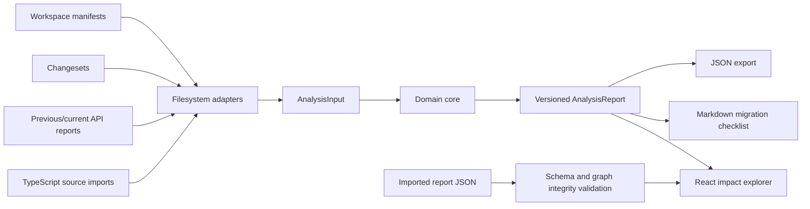

# Architecture

Package Echo Registry is a local-first ports-and-adapters application. The same deterministic
domain core powers the Node CLI, committed demo generation, tests, and static Web viewer without a
registry or source upload.

## System flow

## Dependency direction

| Layer          | Responsibility                                                                 | May depend on                       |
| -------------- | ------------------------------------------------------------------------------ | ----------------------------------- |
| `src/core`     | Models, schemas, API diff, graph rules, risk, privacy, migration, report text. | Standard library and pure libraries |
| `src/adapters` | Filesystem, manifest, Changeset, API report, source usage, report import.      | Core contracts and external formats |
| `src/cli`      | Command parsing, analysis orchestration, JSON/Markdown writes.                 | Core and adapters                   |
| `src/features` | Graph layout and report interaction components.                                | Versioned report model              |
| `src/App.tsx`  | Browser loading, filters, selection, import/export, UI states.                 | Features and report adapter         |
| `scripts`      | Demo, benchmark, screenshot, verification, and E2E lifecycle.                  | Public application entry points     |

The core never reads files, accesses browser globals, performs network I/O, or uses process state.
The analyzed repository is data: no package script or imported source module is executed.

## Analysis phases

1. **Confine and parse.** Resolve every selected path under the workspace root, schema-validate
   manifests and reports, and normalize evidence paths to repository-relative POSIX form.
2. **Build the graph.** Create Graphology nodes for package/consumer/example workspaces and directed
   edges for local dependencies, dev dependencies, and peer dependencies.
3. **Diff APIs.** Pair previous/current snapshots by package and deterministically classify added,
   removed, and normalized-signature changes.
4. **Resolve usage.** Use ts-morph to locate named imports, owning workspace, source file, and line.
5. **Propagate impact.** Traverse only directed downstream paths. A direct source use constrains the
   first hop; later consumers/examples are reached through graph edges.
6. **Check peers.** Evaluate current workspace versions against local peer ranges with semver.
7. **Plan migration.** Deduplicate actions by change and target; release intent alone never creates
   a migration task.
8. **Sanitize and export.** Redact common credential shapes, validate report integrity, and write
   versioned JSON or Markdown.

## Domain invariants

Every impact must:

1. reference an existing change;
2. start its `evidencePath` at `changedPackage`;
3. end at `targetPackage`;
4. traverse graph edges that exist in order;
5. include at least one repository-relative evidence item;
6. carry one of the declared risk and severity values.

Summary counts must equal their arrays. Report import rejects unknown fields, unsupported format
versions, unknown nodes, missing edges, absolute paths, traversal segments, and inconsistent
counts.

An unchanged package can appear in the graph but cannot create a migration task. A Changeset adds
release intent/evidence but cannot by itself turn a compatible change into a breaking impact.

## Evidence model

Evidence is intentionally compact:

- `api-report`: previous/current member existence or normalized signature;
- `changeset`: release intent and human summary;
- `manifest`: exact dependency relationship and range;
- `source`: consumer-relative file, optional line, imported package, and members.

Reports do not include source bodies. Evidence paths are designed for code review and migration
planning rather than probabilistic ranking.

## Report compatibility

`formatVersion` is independent of the npm package version. v0.1.0 reads only the current format
version and fails closed on a future format. A future compatible field requires a format decision,
schema update, integrity tests, fixture regeneration, and viewer support.

Core clocks are injectable; demo and tests use a fixed timestamp. Sorts are explicit so identical
inputs generate stable changes, paths, tasks, and report content.

## Failure semantics

Adapters use stable, non-secret error codes:

- `ROOT_NOT_FOUND`, `MISSING_FILE`, `READ_FAILED`, `PERMISSION_DENIED`;
- `PATH_OUTSIDE_ROOT`;
- `INVALID_JSON`, `INVALID_MANIFEST`, `INVALID_CHANGESET`, `INVALID_API_REPORT`.

The CLI returns a non-zero status and a safe relative path. The Web viewer preserves the current
valid report when a replacement import fails and shows an alert rather than substituting demo data.

## Browser architecture

The viewer is a static Vite build. It fetches only its bundled demo report unless the user selects a
local file. Filtering and graph focus are derived React state; migration completion is session
state. Downloads serialize the currently validated report.

The graph uses a deterministic layered SVG layout. Node interaction is available by pointer, Enter,
and Space. v0.1.0 does not need a Web Worker at the fixture scale; worker extraction is an extension
point for large graph layouts without changing the core contract.

## Extension points

- add another snapshot adapter that produces `ApiSnapshot[]`;
- add source-language usage adapters that produce `SourceUsage[]`;
- add policy rules that consume the graph and emit typed changes/impacts;
- add Git revision selection before parsing without putting Git in the core;
- add CI annotation/rendering adapters that consume `AnalysisReport`.

Each extension should keep external I/O at the boundary, add deterministic fixture coverage, and
preserve report privacy/integrity invariants.
